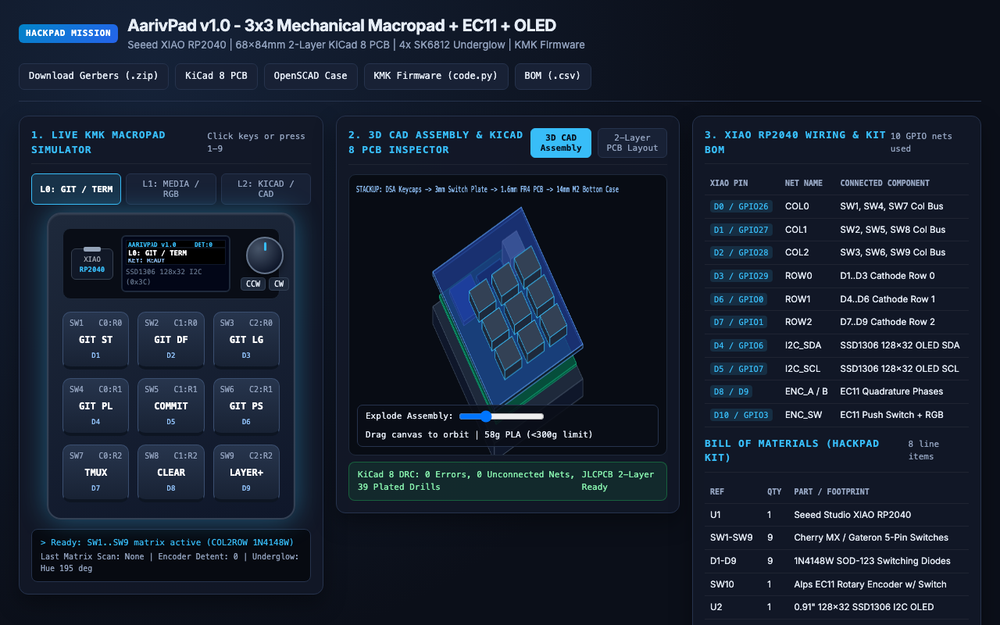

# AarivPad - My 3x3 Mechanical Macropad + EC11 Rotary Encoder + OLED

**Try the Live Interactive 3D Hardware Workbench & KMK Simulator:** [https://aariv.me/hackpad/](https://aariv.me/hackpad/)

I designed and built **AarivPad** for the Hack Club Stardance **Hackpad** mission. It is a custom 3x3 mechanical macropad powered by a **Seeed Studio XIAO RP2040**, an **Alps EC11 rotary encoder** with push-button switch, a **0.91" 128x32 SSD1306 I2C OLED status display**, and four **SK6812 MINI-E reverse-mount addressable RGB underglow LEDs**.

Alongside the complete KiCad 8 schematic, 2-layer routed PCB, JLCPCB Gerber archive, parametric OpenSCAD enclosure STLs, and CircuitPython KMK firmware, I also built an interactive browser workbench at [https://aariv.me/hackpad/](https://aariv.me/hackpad/) so you can test all 9 keys across all 3 macro layers, spin the EC11 encoder, inspect the 2-layer copper traces, and orbit the exploded 3D CAD assembly directly in your browser.

## Why I Built This

Whenever I am working across terminal Git sessions, KiCad PCB layout, and media playback, I constantly find myself reaching for awkward multi-finger keyboard chords (`git status`, `git diff --stat`, `git log --oneline -n 15`, switching tmux panes, or toggling KiCad copper layers and track widths).

I wanted a compact desk companion that sits right next to my mouse and gives me:
1. **Nine tactile mechanical switches** arranged in a standard `19.05mm` (`0.75"`) 3x3 grid for single-press macros.
2. **A physical EC11 rotary encoder** at the top-right corner so I can scrub timelines, adjust volume, or zoom in and out of KiCad/CAD viewports with tactile detents.
3. **A crisp 128x32 SSD1306 OLED screen** at the top-left so I never have to guess which macro layer (`L0: GIT/DEV`, `L1: MEDIA/RGB`, or `L2: KICAD/CAD`) is currently active.

## Features & How It Works Under the Hood

### 1. 3x3 Anti-Ghosting Switch Matrix + Peripherals on 11 GPIOs
Because the **Seeed Studio XIAO RP2040** exposes exactly 11 user GPIO pins (`D0` through `D10`), fitting 9 switches, a quadrature rotary encoder + push button, an I2C OLED display, and an addressable RGB LED chain required careful pin budgeting:
- **Columns (`COL0..COL2`)**: Wired to `D0` (`GPIO26`), `D1` (`GPIO27`), and `D2` (`GPIO28`).
- **Rows (`ROW0..ROW2`)**: Wired to `D3` (`GPIO29`), `D6` (`GPIO0`), and `D7` (`GPIO1`) through nine `1N4148W` SOD-123 switching diodes (`D1..D9`) oriented `COL2ROW` so pressing any combination of keys simultaneously never causes ghosting.
- **Hardware I2C0 (`SDA` / `SCL`)**: Reserved `D4` (`GPIO6`) and `D5` (`GPIO7`) for the 0.91" 128x32 SSD1306 OLED display at address `0x3C`.
- **EC11 Encoder & Underglow Chain**: Quadrature channels `ENC_A` and `ENC_B` connect to `D8` (`GPIO2`) and `D9` (`GPIO4`), while `D10` (`GPIO3`) handles the encoder push switch (`ENC_SW`) and drives the 4-pixel `SK6812 MINI-E` RGB underglow chain.

### 2. Three-Layer KMK Firmware (`firmware/code.py`)
I wrote the firmware in CircuitPython using **KMK** (`kmk_keyboard`, `Layers`, `EncoderHandler`, `RGB`, and `adafruit_displayio_ssd1306`):
- **Layer 0 (`GIT / TERMINAL`)**: Single-key macros for `git status -sb`, `git diff --stat`, `git add -A && git commit`, `git log --oneline -n 12`, `git pull --rebase`, `git push`, tmux pane split, terminal clear, and layer cycle (`DF(1)`). Rotary dial scrolls terminal history line by line.
- **Layer 1 (`MEDIA / RGB`)**: Play/Pause, Next/Previous Track, Mute, RGB Hue/Animation toggle, Brightness step, and Window Snap shortcuts. Rotary dial controls system volume (`VOL+` / `VOL-`).
- **Layer 2 (`KICAD / CAD`)**: KiCad track routing (`X`), via placement (`V`), copper layer flip (`F.Cu <-> B.Cu`), DRC inspector, 3D viewer launch (`Alt+3`), and measurement tool. Rotary dial zooms the canvas in and out.

### 3. 2-Layer 68mm x 84mm PCB & Parametric OpenSCAD Enclosure
- **KiCad 8 PCB (`pcb/aarivpad.kicad_pcb`)**: Routed on a compact `68.0mm x 84.0mm` two-layer board with `1.6mm` FR4 thickness, rounded `3.0mm` corners, four `M2` mounting holes (`4.0mm` inset), `0.25mm` signal traces (`0.50mm` power rails), and stitched `GND` copper pours on both `F.Cu` and `B.Cu`.
- **3D-Printable Case (`cad/aarivpad_case.scad`)**: Includes a heat-set `M2` bottom tray (`bottom_case.stl`), a `1.5mm`/`3.0mm` clip-in MX switch plate (`switch_plate.stl`) with a framed viewport over the OLED and clearance for the EC11 bushing, and a knurled `6.0mm` D-shaft knob (`encoder_knob.stl`). Total print weight is `~58g` PLA - well under the 300g Printing Legion limit.

## What Was Tricky to Build

1. **Fitting 9 Keys + OLED + EC11 + RGB onto the XIAO RP2040's 11 Pins**:
   A direct-pin wiring approach would have needed `9 (switches) + 2 (I2C) + 3 (encoder) + 1 (RGB) = 15 GPIOs`, which exceeds the XIAO RP2040's 11 pins. Scanning the 9 switches as a `3x3` diode matrix reduced the switches from 9 pins down to 6 (`3 cols + 3 rows`), leaving `D4/D5` free for hardware I2C and `D8/D9/D10` free for the EC11 encoder and RGB chain.
2. **Preventing Mechanical Interference Between the OLED Header and Top Switch Row**:
   On a tight `68mm x 84mm` board, placing the XIAO RP2040, the 0.91" OLED module, and the EC11 rotary encoder along the top header zone required carefully offsetting the OLED center to `(22.0mm, 14.5mm)` and the EC11 shaft to `(52.5mm, 14.5mm)` so the top switch row (`SW1..SW3` at `Y = 34.0mm`) clears both the OLED PCB edge and the 18mm knurled encoder knob with zero keycap rub.

## XIAO RP2040 Pinout & Matrix Wiring

| Seeed XIAO RP2040 Pin | Net Name | Connected Hardware |
| --- | --- | --- |
| `D0 / GPIO26` | `COL0` | Column 0 Switch Bus (`SW1`, `SW4`, `SW7`) |
| `D1 / GPIO27` | `COL1` | Column 1 Switch Bus (`SW2`, `SW5`, `SW8`) |
| `D2 / GPIO28` | `COL2` | Column 2 Switch Bus (`SW3`, `SW6`, `SW9`) |
| `D3 / GPIO29` | `ROW0` | Row 0 Diode Bus (`D1`, `D2`, `D3` cathodes) |
| `D6 / GPIO0` | `ROW1` | Row 1 Diode Bus (`D4`, `D5`, `D6` cathodes) |
| `D7 / GPIO1` | `ROW2` | Row 2 Diode Bus (`D7`, `D8`, `D9` cathodes) |
| `D4 / GPIO6 (SDA)` | `I2C_SDA` | 0.91" 128x32 SSD1306 OLED Display (`SDA`) |
| `D5 / GPIO7 (SCL)` | `I2C_SCL` | 0.91" 128x32 SSD1306 OLED Display (`SCL`) |
| `D8 / GPIO2` | `ENC_A` | EC11 Rotary Encoder Phase A |
| `D9 / GPIO4` | `ENC_B` | EC11 Rotary Encoder Phase B |
| `D10 / GPIO3` | `ENC_SW` | EC11 Push Switch + SK6812 RGB Underglow Chain |
| `3V3 / 5V / GND` | Power | OLED `VCC` (`3V3`), SK6812 `VDD` (`5V`), Common Ground |

## Bill of Materials (Hackpad Kit Compatible)

| Ref | Qty | Component | Footprint / Package |
| --- | --- | --- | --- |
| `U1` | 1 | Seeed Studio XIAO RP2040 | Through-hole / SMD 14-pin Module |
| `SW1-SW9` | 9 | Cherry MX / Gateron 5-Pin Mechanical Switches | `SW_Cherry_MX_1.00u_PCB` |
| `D1-D9` | 9 | 1N4148W / 1N4148 Switching Diodes | `D_SOD-123` (THT compatible pads) |
| `SW10` | 1 | Alps EC11 Rotary Encoder with Push Switch | `RotaryEncoder_Alps_EC11E-Switch` |
| `U2` | 1 | 0.91" 128x32 SSD1306 I2C OLED Display | 4-Pin 2.54mm Header (`GND/VCC/SCL/SDA`) |
| `LED1-LED4` | 4 | SK6812 MINI-E Addressable RGB LEDs | Reverse-Mount `PLCC4 3.2x2.8mm` |
| `K1-K9` | 9 | 1u Blank DSA PBT Keycaps | Standard MX Stem |
| `H1-H4` | 4 | M2x8mm Screws + M2x5mm Brass Heat-Set Inserts | 2.2mm Mounting Holes |

## Repository Structure & How to Explore It

- **Interactive Browser Workbench**: Open [https://aariv.me/hackpad/](https://aariv.me/hackpad/) (or open `index.html` locally) to test the 9-key KMK macro simulator with Web Audio mechanical switch clicks, rotate the EC11 encoder, inspect the 2-layer PCB traces (`F.Cu`, `B.Cu`, `F.SilkS`), and orbit the 3D exploded CAD assembly.
- **KiCad 8 Design Files**: Open `pcb/aarivpad.kicad_pro` in KiCad 8 to inspect the schematic (`pcb/aarivpad.kicad_sch`) and routed PCB (`pcb/aarivpad.kicad_pcb`). Fabrication-ready Gerbers are zipped at `pcb/gerbers/aarivpad-gerbers.zip`.
- **3D Enclosure CAD**: Open `cad/aarivpad_case.scad` in OpenSCAD or slice `cad/bottom_case.stl`, `cad/switch_plate.stl`, and `cad/encoder_knob.stl` directly in Bambu Studio / PrusaSlicer.
- **Firmware**: Copy `firmware/code.py` onto your XIAO RP2040's `CIRCUITPY` drive with the `kmk` and `adafruit_displayio_ssd1306` libraries installed.

## License

MIT.
